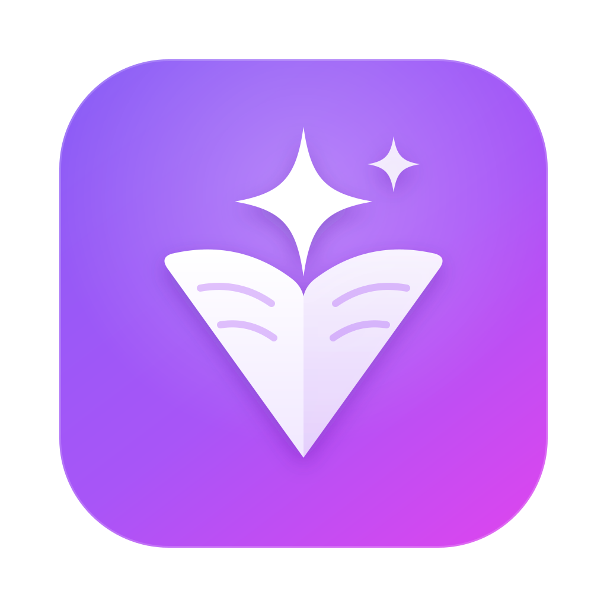
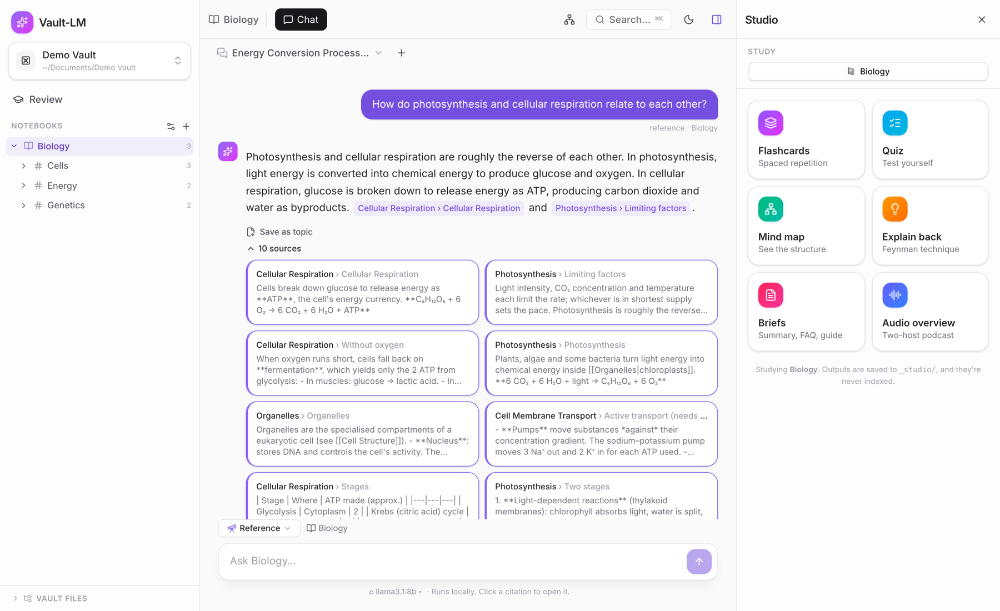
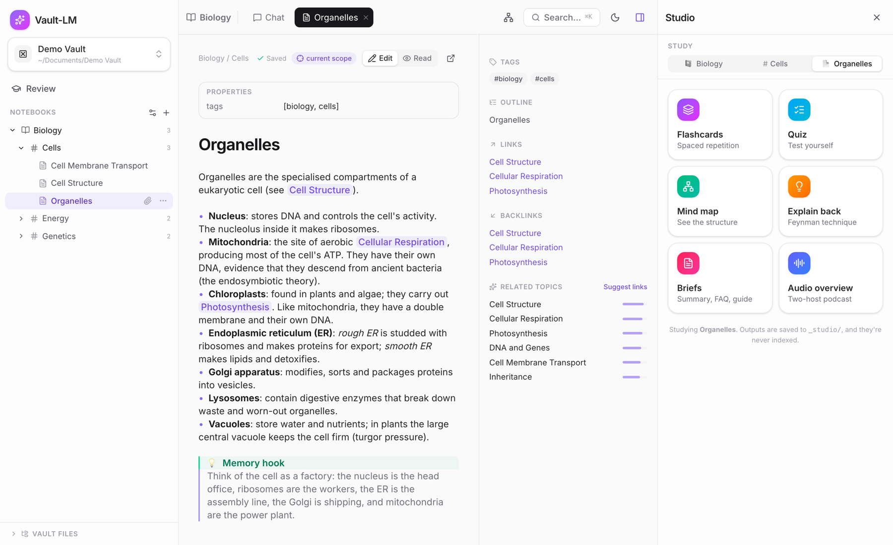

<div align="center">



# Vault-LM

**Turn a folder of Markdown notes into a study partner that runs on your computer.**

Cited chat over your notes, flashcards with spaced repetition, quizzes, mind maps and audio overviews.
It works with local models through [Ollama](https://ollama.com), so nothing has to leave your machine.

[](https://github.com/willgoodson/vault-lm/releases/latest)
[](https://github.com/willgoodson/vault-lm/actions/workflows/ci.yml)
[](LICENSE)

</div>



## Features

- **Chat with your notes.** Answers come only from the notebook you're in, and every claim links back to the note it came from.
- **Study tools ("Studio").**
  - Flashcards with spaced repetition
  - Quizzes, mind maps and Explain-back (the Feynman technique)
  - Summaries, FAQs and study guides
  - A two-host audio overview you can listen to
- **Review dashboard.** Cards due today, your weak spots from missed questions, and an activity heatmap.
- **A real Markdown editor.** It has live preview, `[[wikilinks]]`, backlinks and related notes, a graph of your notes, and ⌘K search.
- **Import sources.** Bring in web pages, PDFs (scans are read with on-device OCR), EPUBs, images and YouTube transcripts.
- **Works with Obsidian.** Your vault stays a plain folder of `.md` files, and Vault-LM never touches Obsidian's settings.
- **Your choice of model.** Use local models through Ollama, Claude (Anthropic), or any OpenAI-compatible service. API keys are stored in your system keychain.



## Download

Get the latest version from the **[Releases page](https://github.com/willgoodson/vault-lm/releases/latest)**:

| System | File |
|---|---|
| macOS (Apple Silicon) | `Vault-LM_<version>_aarch64.dmg` |
| macOS (Intel) | `Vault-LM_<version>_x64.dmg` |
| Windows 10/11 | `Vault-LM_<version>_x64-setup.exe` (or the `.msi`) |
| Linux | `.AppImage`, `.deb` (Debian/Ubuntu) or `.rpm` (Fedora) |

> [!NOTE]
> The app isn't code-signed yet, so your system asks you to confirm the first time you open it:
> - **macOS:** open the app once, then go to **System Settings → Privacy & Security** and click **Open Anyway**.
> - **Windows:** on the "Windows protected your PC" screen, click **More info → Run anyway**.

## Getting started

1. **Install a model.** Install [Ollama](https://ollama.com/download), then download a chat model and an embedding model (used for search):
   ```sh
   ollama pull llama3.1:8b
   ollama pull nomic-embed-text
   ```
   Prefer a cloud model? Skip this step and add a key in **Models…** (⌘, on Mac) once the app is open. You'll still need an embedding model for search: either Ollama's or an OpenAI-compatible one.
2. **Open Vault-LM** and choose a folder of notes, or create a new vault. To try it with sample notes, download [`examples/demo-vault`](examples/demo-vault) and open that folder.
3. **Pick a notebook** in the sidebar and ask a question, or open **Studio** to make flashcards and quizzes.

New to it? The **[User guide](docs/USER-GUIDE.md)** explains how notebooks, sections and topics work, the two chat modes, and every study tool.

## How your notes are organised

| In Vault-LM | On disk |
|---|---|
| **Notebook** | a top-level folder |
| **Section** | a subfolder |
| **Topic** | a single `.md` note |

Generated study material goes into a `_studio/` folder inside each notebook. Imported sources are saved as Markdown next to the notes they belong to.

## Privacy

- Your notes stay in your folder, and the search index stays on your computer.
- With a local model, nothing leaves your machine.
- With a cloud model, your question and the matching excerpts from your notes go to that provider. The app shows ☁ next to the model name whenever that's the case.
- There is no account, telemetry or analytics.

## Building from source

You need Rust, Node 22, `protoc` and the PDFium library (setup in [docs/DEVELOPMENT.md](docs/DEVELOPMENT.md#prerequisites)). Then:

```sh
git clone https://github.com/willgoodson/vault-lm && cd vault-lm
npm ci
npm run desktop          # run in development
npm run desktop:build    # build an installer for this machine
```

See **[docs/DEVELOPMENT.md](docs/DEVELOPMENT.md)** for the architecture, the tests and the release process.

## Contributing

Bug reports and ideas are welcome: please [open an issue](https://github.com/willgoodson/vault-lm/issues/new/choose). If you'd like to contribute code, read [CONTRIBUTING.md](CONTRIBUTING.md) first.

## License

[MIT](LICENSE) © 2026 William Goodson.

Vault-LM bundles open-source libraries under their own licenses. They're listed in [`THIRD-PARTY-NOTICES.txt`](src-tauri/resources/THIRD-PARTY-NOTICES.txt), and in the app under **Help → Third-Party Licenses**.

Vault-LM isn't affiliated with Obsidian, Ollama, Anthropic, OpenAI or Google.
